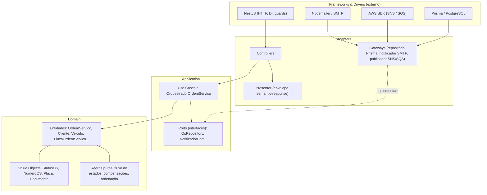
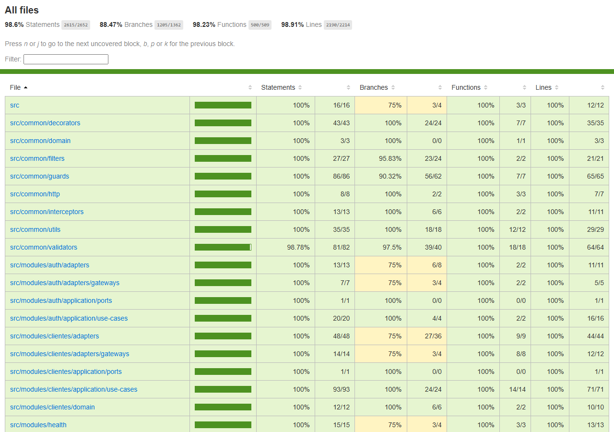

# tc-oficina-os-service — Serviço de Ordens de Serviço

[](https://github.com/FIAP-POS-TECH-SOFTWARE-ARCHITECTURE/tc-oficina-os-service/actions/workflows/ci.yml)

Serviço de ordens de serviço (OS) da oficina mecânica — Tech Challenge FIAP SOAT, Fase 4,
grupo **Integradores**. API REST NestJS em Clean Architecture que concentra os cadastros e o
ciclo de vida da OS e hospeda o **orquestrador da Saga** que coordena o atendimento entre os
três microsserviços da solução.

## Propósito ✱

Na Fase 4 o monólito da Fase 3 foi dividido em três microsserviços (`os-service`,
`billing-service`, `execution-service`), cada um com o seu banco. O `os-service` é dono de:

- **cadastros**: usuários internos, clientes, veículos, catálogo de serviços, estoque de insumos
  (com compras) e a reserva/estorno de estoque;
- **ordem de serviço**: abertura (número `OS-<ano>-<seq>`), status, histórico, listagem
  priorizada, acompanhamento pelo cliente, entrega e cancelamento;
- **orquestração**: o módulo `orquestracao-os` decide o próximo passo de cada OS, envia comandos
  ao Execution e ao Billing por filas SQS, consome os eventos deles, aplica as compensações e
  controla os prazos.

**Papel na Saga:** orquestrador. Billing (orçamento e pagamento) e Execution (filas de
diagnóstico e reparo) não conhecem o OS nem uns aos outros: recebem comandos e publicam eventos.
Cada OS em andamento tem um `FluxoOrdemServico` (uma linha em `fluxos_ordem_servico`) que guarda
a etapa, o status e os prazos da Saga.

A aplicação roda atrás do **API Gateway HTTP API** (autenticação de cliente por CPF via Lambda,
em `tc-oficina-lambda-auth`) em dois ambientes, `homolog` e `prod`, separados por namespace no
EKS e por banco lógico no RDS, e emite telemetria para o New Relic (APM, logs estruturados com
`requestId`, métricas de negócio e rastreamento distribuído entre os serviços).

## Tecnologias ✱

| Camada | Tecnologia |
| --- | --- |
| Runtime | Node.js 25 (imagem `node:25-alpine`) + TypeScript |
| Framework | NestJS 11 |
| Banco | PostgreSQL 18 (RDS em produção) — `oficina-db` |
| ORM | Prisma 6 |
| Mensageria | Amazon SNS + SQS (AWS SDK v3), com outbox transacional e idempotência por `messageId` |
| Contratos | JSON Schema (Ajv) em [`contratos/`](contratos/README.md), validados na publicação e no consumo |
| Auth interna | JWT HS256 + Argon2, guard de papéis (`ATENDENTE`, `MECANICO`, `ESTOQUISTA`, `ADMINISTRADOR`) |
| Auth de cliente | JWT HS256 emitido pela Lambda, validado por Lambda Authorizer + `JwtAuthGuard` |
| Testes | Jest 30 + `jest-cucumber` (BDD) + Supertest + Testcontainers + MiniStack |
| Qualidade | SonarQube (quality gate com cobertura mínima de 80%) |
| Carga | k6 |
| Observabilidade | New Relic (APM + `nestjs-pino` + `nri-bundle`) |
| Containers | Docker + Docker Compose |
| Orquestração | Kubernetes (EKS), Kustomize, HPA por CPU, rolling update |
| CI/CD | GitHub Actions |
| Emulador AWS local | MiniStack (SNS/SQS/SSM/DynamoDB) |
| E-mail (dev) | Mailhog |
| Cliente de API | Bruno (export Postman disponível) |

## Arquitetura deste repositório ✱

Visão da solução: [`docs/arquitetura/visao-geral-microsservicos.md`](docs/arquitetura/visao-geral-microsservicos.md)
(componentes, bancos, filas e comunicação). Índice completo da documentação (componentes,
sequências, RFCs, ADRs, banco de dados): [`docs/arquitetura/`](docs/arquitetura/README.md).
Observabilidade: [`docs/observabilidade/`](docs/observabilidade/README.md).

Cada módulo de `src/modules/` (`auth`, `usuarios`, `clientes`, `veiculos`, `servicos`,
`insumos`, `ordens-servico`, `orquestracao-os`, `mensageria`, `health`) segue a Clean
Architecture em camadas, com a regra de dependência apontando sempre para dentro:



Regras invioláveis: `domain` não importa Nest/Prisma; `application` só importa `domain`;
`adapters` importam `application`/`domain`. Use cases recebem dependências por interface
(ports) via injeção. As regras de negócio (transições de status, decisões do fluxo, ordenação)
são código puro de domínio. O envelope de resposta padronizado (`semantic-response`,
interceptor global) cumpre o papel de Presenter.

### Saga Pattern — estratégia orquestrada

O enunciado exige o **Saga Pattern** para coordenar o atendimento da OS, com rollback e
compensação em qualquer etapa. A escolha foi a **Saga orquestrada**, com o orquestrador dentro
deste serviço — decisão completa na [ADR-008](docs/arquitetura/adrs/adr-008-saga-orquestrada.md).

**Por que orquestrada e não coreografada.** O fluxo tem sete passos, prazos e compensações que
dependem da etapa em que a OS está. Espalhar isso entre três serviços deixaria a regra "o que
desfazer em cada ponto" sem dono; com o orquestrador, fluxo e compensações ficam num lugar só,
o BDD do fluxo completo roda contra o orquestrador real e o estado da Saga é uma linha
consultável (`GET /orquestracao/fluxos/:osId`). Um orquestrador como serviço separado foi
descartado porque o OS já é dono da OS e do estoque, e a reserva de estoque e a mudança de
status virariam chamadas remotas.

**Onde está o código.** `src/modules/orquestracao-os`. No código o termo "Saga" não aparece:

| Conceito | Nome no código |
| --- | --- |
| Orquestrador da Saga | `OrquestradorOrdemServico` (`src/modules/orquestracao-os/application/orquestrador-ordem-servico.ts`) |
| Instância da Saga (estado de uma OS no fluxo) | `FluxoOrdemServico` (`src/modules/orquestracao-os/domain/fluxo-ordem-servico.ts`; tabela `fluxos_ordem_servico`, um fluxo por OS) |
| Passo atual / situação | `etapa` (`EtapaFluxoOs`) / `status` (`StatusFluxoOs`: `EM_ANDAMENTO`, `COMPENSANDO`, `CONCLUIDO`, `COMPENSADO`, `FALHA_TECNICA`) |

Cada decisão (mudar a etapa, mudar o status da OS, reservar ou estornar estoque e gravar o
próximo comando no outbox) acontece numa única transação Postgres.

**Passos e compensações.** Abertura da OS → diagnóstico (Execution) → reserva de estoque
(local) → orçamento e aprovação do cliente (Billing) → pagamento → reparo (Execution) → OS
finalizada. Até o pagamento tudo é compensável (cancelar execução, cancelar orçamento, estornar
a reserva); depois do pagamento só o `ReparoInviavel` compensa sozinho (estorno do pagamento),
e `ReparoConcluido` é o ponto sem volta. Uma falha técnica depois do pagamento leva o fluxo a
`FALHA_TECNICA`, decidido por um `ADMINISTRADOR` (`reprocessar` ou `compensar`). Diagramas:
[`sequencia-fluxo-os.md`](docs/arquitetura/sequencia-fluxo-os.md) (caminho feliz) e
[`sequencia-compensacao.md`](docs/arquitetura/sequencia-compensacao.md) (compensações e
estados do fluxo).

**Falta de isolamento (o I do ACID).** Cada passo é confirmado no banco do seu serviço antes do
próximo, então duas anomalias são possíveis e o projeto aplica uma contramedida para cada:

| Anomalia | Exemplo neste fluxo | Contramedida |
| --- | --- | --- |
| **Dirty read** — ler dado de uma Saga que ainda pode ser desfeita | O cliente tenta aprovar ou pagar um orçamento que a Saga está cancelando; o estoque reservado aparece como consumido para uma OS que será compensada | **Visão Pessimista**: reordenar os passos. A reserva de estoque (local, desfeita por estorno) vem antes de qualquer passo de dinheiro, e o pagamento é o último passo antes do reparo — até o pagamento tudo é compensável |
| **Lost update** — duas atualizações concorrentes, uma sobrescrevendo a outra | Duas réplicas processam ao mesmo tempo `OrcamentoAprovado` e o job de prazo vencido do mesmo fluxo; no Billing, a aprovação do cliente corre contra o `CancelarOrcamento` | **Rever/Reler Valor**: reler o dado antes de atualizar. Aqui, toda transação do orquestrador começa com `SELECT ... FOR UPDATE` na linha de `fluxos_ordem_servico` e só então lê o `FluxoOrdemServico` e decide; no Billing, a escrita no DynamoDB é condicional por `versao` |

Como complemento, nos termos do livro de referência: o status do fluxo funciona como *semantic
lock* (OS com fluxo ativo só muda pelo orquestrador), os passos até o pagamento são
*compensáveis*, `ReparoConcluido` é o *pivô* e o que vem depois é *retentável*.

Documentos relacionados: [visão geral](docs/arquitetura/visao-geral-microsservicos.md),
[sequência do fluxo da OS](docs/arquitetura/sequencia-fluxo-os.md),
[sequência das compensações](docs/arquitetura/sequencia-compensacao.md),
[ADR-009 (mensageria)](docs/arquitetura/adrs/adr-009-mensageria-sns-sqs.md) e
[ADR-012 (outbox e idempotência)](docs/arquitetura/adrs/adr-012-outbox-e-idempotencia.md).

## Comunicação ✱

### Assíncrona (SNS/SQS)

Os nomes físicos levam o prefixo `oficina-<env>-` (`homolog`, `prod`, ou `local` no emulador) e
cada fila tem uma DLQ `-dlq`. Catálogo completo de mensagens, schemas e regras de idempotência:
[`contratos/README.md`](contratos/README.md).

| Sentido | Recurso | Tipos de mensagem |
| --- | --- | --- |
| Produz (comando) | fila `oficina-<env>-execucao-comandos` | `SolicitarDiagnostico`, `IniciarReparo`, `CancelarExecucao` |
| Produz (comando) | fila `oficina-<env>-billing-comandos` | `GerarOrcamento`, `CancelarOrcamento`, `EstornarPagamento` |
| Produz (evento informativo) | tópico SNS `oficina-<env>-eventos` | `FluxoConcluido`, `FluxoCompensado` |
| Consome (eventos do Execution) | fila `oficina-<env>-os-orquestrador-eventos` | `ExecucaoEnfileirada`, `DiagnosticoIniciado`, `DiagnosticoConcluido`, `DiagnosticoRejeitado`, `ReparoIniciado`, `ReparoConcluido`, `ReparoInviavel`, `ExecucaoCancelada` |
| Consome (eventos do Billing) | fila `oficina-<env>-os-orquestrador-eventos` | `OrcamentoGerado`, `FalhaGerarOrcamento`, `OrcamentoAprovado`, `OrcamentoRejeitado`, `OrcamentoCancelado`, `PagamentoConfirmado`, `PagamentoEstornado`, `EstornoFalhou` |

A fila `os-orquestrador-eventos` é assinante do tópico com filtro `origem` em `billing` e
`execution`. Os comandos saem pelo outbox (relay) e o consumo é idempotente por `messageId`.
Um job a cada minuto aplica os prazos `PRAZO_APROVACAO`, `PRAZO_PAGAMENTO` e
`PRAZO_RESPOSTA_SERVICO`.

### Síncrona (REST)

| Rota | Quem chama | Auth |
| --- | --- | --- |
| `GET /internal/clientes/por-documento/:documento` | Lambda de token (direto no LoadBalancer) | header `x-internal-api-key` |
| `GET /internal/catalogo/servicos`, `GET /internal/catalogo/insumos` | execution-service (DNS interno do cluster) | header `x-internal-api-key` |
| `GET /health`, `GET /health/ready` | probes do Kubernetes | pública |

As rotas de negócio (OS, cadastros, orquestração) estão na seção [API](#api-).

## Como executar localmente ✱

Pré-requisitos: Node.js, Docker e Docker Compose.

```bash
cp .env.example .env                  # Windows: Copy-Item .env.example .env
npm install
npx prisma generate

docker compose -f dev/docker-compose.yml up -d postgres   # Postgres 18 em localhost:5432
npx prisma migrate deploy
npm run db:seed                       # usuários, clientes, veículos, serviços e insumos de exemplo

npm run ministack:up                  # emulador AWS (SNS/SQS) em localhost:4566
npm run mensageria:local              # cria filas, DLQs, tópico e assinatura; imprime 4 variáveis
# colar as 4 linhas impressas (SNS_EVENTOS_ARN e as 3 SQS_*_URL) no .env

npm run start:dev                     # API em http://localhost:3000
```

No `.env.example` o host do Postgres é `postgres` (rede do Docker Compose); ao rodar com
`npm run start:dev` na máquina, ajustar `DATABASE_URL` para `localhost`. Para só exercitar as
APIs sem mensageria, defina `WORKERS_HABILITADOS=false` (desliga consumidor de fila, relay de
outbox e jobs).

Variáveis mínimas (base em [`.env.example`](.env.example)):

| Variável | Uso |
| --- | --- |
| `PORT`, `DATABASE_URL`, `JWT_SECRET`, `JWT_EXPIRES_IN` | HTTP, banco e JWT |
| `ADMIN_BOOTSTRAP_EMAIL`, `ADMIN_BOOTSTRAP_PASSWORD` | usuário administrador criado no boot (`BootstrapAdminUseCase`) |
| `INTERNAL_API_KEY` | chave das rotas `/internal` |
| `AWS_REGION`, `AWS_ENDPOINT_URL`, `AWS_ACCESS_KEY_ID`, `AWS_SECRET_ACCESS_KEY` | AWS SDK; as três últimas só no emulador local |
| `SNS_EVENTOS_ARN`, `SQS_EXECUCAO_COMANDOS_URL`, `SQS_BILLING_COMANDOS_URL`, `SQS_OS_ORQUESTRADOR_EVENTOS_URL` | mensageria |
| `SQS_DLQ_URLS` | CSV das DLQs monitoradas; vazio desliga o monitor |
| `PRAZO_APROVACAO`, `PRAZO_PAGAMENTO`, `PRAZO_RESPOSTA_SERVICO` | prazos do fluxo, em minutos inteiros |
| `WORKERS_HABILITADOS` | `false` desliga os workers |
| `SMTP_HOST`, `SMTP_PORT`, `SMTP_FROM` | notificação por e-mail (Mailhog em dev) |
| `NEW_RELIC_LICENSE_KEY`, `NEW_RELIC_APP_NAME` | observabilidade (só no cluster) |

Outros comandos úteis: `npm run ministack:down` para parar o emulador;
`docker compose up -d --build` (na raiz) sobe API + Postgres + Mailhog num único comando, usando
o `.env` — Swagger em <http://localhost:3000/docs>, health em <http://localhost:3000/health> e
Mailhog em <http://localhost:8025>. Manifestos Kubernetes em [`k8s/`](k8s/README.md) (Kustomize
`k8s/base/` + `k8s/overlays/{homolog,prod}/`).

## Testes e qualidade ✱

```bash
npm test                  # unitários + BDD (jest-cucumber) (requer Docker)
npm run test:cov          # unitários + BDD com cobertura (thresholds de 80% no package.json)
npm run test:integracao   # MiniStack real via Testcontainers (requer Docker)
npm run test:e2e          # e2e com Testcontainers, Postgres real (requer Docker; antes: cp .env.test.example .env.test)
npm run lint:check
npm run sonar:up && npm run sonar:scan   # SonarQube local com quality gate
```

Os cenários BDD ficam em [`test/bdd/features/`](test/bdd/features/): `fluxo-ordem-servico.feature`
(fluxo completo da Saga contra o orquestrador real, com compensações) e
`fluxo-estados-os.feature` (estados da OS). Os steps estão em `test/bdd/steps/`.

**Cobertura** — medida localmente com `npm run test:cov` (126 suítes, 801 testes, todos
verdes):

| Métrica | Cobertura | Cobertos / total |
| --- | --- | --- |
| Statements | 98,6% | 2615 / 2652 |
| Branches | 88,47% | 1205 / 1362 |
| Functions | 98,23% | 500 / 509 |
| Lines | 98,91% | 2190 / 2214 |



**Quality gate.** O job `Qualidade (SonarQube)` do CI sobe um SonarQube, aplica o gate
"Cobertura 80" e reprova o PR se a cobertura ficar abaixo de 80% (branches incluídas). O último
run verde do CI do PR que levou esta versão à `develop` (lint, build, testes unitários e BDD,
e2e com integração e o job do quality gate) está em
[actions/runs/41743782970](https://github.com/FIAP-POS-TECH-SOFTWARE-ARCHITECTURE/tc-oficina-os-service/actions/runs/41743782970).

## Deploy ✱

| Workflow | Gatilho | O que faz |
| --- | --- | --- |
| `.github/workflows/ci.yml` | PR para `main`/`develop`; `workflow_dispatch` | jobs `Lint, build e testes unitários` (lint, build, `test:cov`, publica o artefato `cobertura-os-service`), `Testes e2e (Testcontainers)` (e2e + integração com MiniStack) e `Qualidade (SonarQube)` (quality gate) |
| `.github/workflows/cd.yml` | `push` para `develop` (→ `homolog`) e `main` (→ `prod`); `workflow_dispatch` | build e push da imagem no ECR `oficina-os-service` (tag `<env>-<sha>`) · cria o Secret `os-service-secrets` a partir do SSM · migração (`prisma migrate deploy` num Job) · `kubectl apply -k k8s/overlays/<env>` · `rollout status` e smoke test de `/health` · publica o hostname do LoadBalancer no SSM |

**Ambientes por branch:** `develop` → `homolog`, `main` → `prod`; feature branches + PR
obrigatório. A `main` tem branch protection (PR com aprovação e CI verde).

**Estratégia de deploy:** rolling update do Kubernetes (`maxUnavailable: 0`, `maxSurge: 1`,
2 réplicas, HPA de 2 a 10 por CPU) — ver
[ADR-015](docs/arquitetura/adrs/adr-015-estrategia-de-deploy-rolling-update.md).

**Secrets do repositório:** `AWS_ACCESS_KEY_ID`, `AWS_SECRET_ACCESS_KEY`, `AWS_SESSION_TOKEN`
(AWS Academy, rotativos — `scripts/aws-academy-refresh.ps1` renova e propaga para os
repositórios), `ADMIN_BOOTSTRAP_EMAIL`, `ADMIN_BOOTSTRAP_PASSWORD`, `NEW_RELIC_LICENSE_KEY`.

**Parâmetros SSM lidos pelo CD** (`/oficina/<env>/...`): `database-url`, `jwt-secret`,
`internal-api-key`, `mensageria/eventos-topic-arn`, `mensageria/execucao-comandos-url`,
`mensageria/billing-comandos-url`, `mensageria/os-orquestrador-eventos-url` e as três
`mensageria/*-dlq-url`. Sem a infraestrutura de mensageria aplicada, o deploy falha de
propósito. O CD escreve `os-service-lb-hostname` (e `app-lb-hostname`, durante a migração da
borda) para o gateway.

O `terraform apply` da infraestrutura é **manual**, documentado em `tc-oficina-infra-k8s` e
`tc-oficina-infra-db`; este pipeline faz só o deploy da aplicação.

## API ✱

Swagger do serviço: `/docs` — pelo gateway, `https://<gateway>/docs`; local,
<http://localhost:3000/docs>. As rotas de billing e execution têm Swagger próprio
(`/billing/docs` e `/execucao/docs`).

| Grupo | Rotas principais | Auth |
| --- | --- | --- |
| Login | `POST /auth/login` | pública |
| OS | `POST /os` (abertura) · `GET /os` (listagem priorizada) · `GET /os/:id` · `GET /os/:id/historico` · `GET /os/metricas/tempo-medio` · `POST /os/:id/entregar` · `POST /os/:id/cancelar` · `POST /os/:id/desbloquear` | JWT interno (papéis por rota) |
| Acompanhamento do cliente | `GET /os/acompanhamento/:numero` | token de cliente (CPF); `403` se a OS é de outro cliente, `404` se não existe |
| Orquestração | `GET /orquestracao/fluxos/:osId` · `POST /orquestracao/fluxos/:fluxoId/reprocessar` · `POST /orquestracao/fluxos/:fluxoId/compensar` | `ADMINISTRADOR` |
| Cadastros | `/clientes`, `/clientes/:clienteId/veiculos`, `/veiculos`, `/servicos`, `/insumos`, `/insumos/compras`, `/usuarios` | JWT interno (papéis por rota) |
| Internas | `/internal/clientes/por-documento/:documento`, `/internal/catalogo/servicos`, `/internal/catalogo/insumos` | `x-internal-api-key`; bloqueadas no gateway |
| Saúde | `GET /health`, `GET /health/ready` | pública |

Orçamento, aprovação e pagamento ficam no `billing-service` (`/billing/...`) e a fila de
trabalho do mecânico no `execution-service` (`/execucao/...`). O diagnóstico, os itens e a
finalização da OS acontecem pelo fluxo orquestrado, não por rotas deste serviço.

**Collection:** [`bruno/Oficina-API`](bruno/Oficina-API) (abrir com
[Bruno](https://www.usebruno.com/downloads) via **Open Collection**, ambiente **Local**, rodar
`Auth > Login` — o script salva o JWT na variável `token`) · export equivalente:
[`bruno/oficina-api.postman_collection.json`](bruno/oficina-api.postman_collection.json).

## Links ✱

- **Documentação arquitetural:** [`docs/arquitetura/`](docs/arquitetura/README.md) (visão geral,
  componentes, sequências, RFCs, ADRs, DER).
- **Contratos entre os serviços:** [`contratos/README.md`](contratos/README.md).
- **Observabilidade:** [`docs/observabilidade/`](docs/observabilidade/README.md) (dashboards,
  alertas, runbook).
- **Demais repositórios da solução:**
  [`tc-oficina-billing-service`](https://github.com/FIAP-POS-TECH-SOFTWARE-ARCHITECTURE/tc-oficina-billing-service) ·
  [`tc-oficina-execution-service`](https://github.com/FIAP-POS-TECH-SOFTWARE-ARCHITECTURE/tc-oficina-execution-service) ·
  [`tc-oficina-lambda-auth`](https://github.com/FIAP-POS-TECH-SOFTWARE-ARCHITECTURE/tc-oficina-lambda-auth) ·
  [`tc-oficina-infra-k8s`](https://github.com/FIAP-POS-TECH-SOFTWARE-ARCHITECTURE/tc-oficina-infra-k8s) ·
  [`tc-oficina-infra-db`](https://github.com/FIAP-POS-TECH-SOFTWARE-ARCHITECTURE/tc-oficina-infra-db)
- **Vídeo de demonstração:** a publicar. Vídeos das fases anteriores: Fase 1
  <https://youtu.be/2yV4mSfs1Uw> · Fase 2 <https://youtu.be/5Tm29h77mHA>.

## Grupo Integradores

| Nome | RM |
| --- | --- |
| Lucas Gardini Dias | 372237 |
| Thiago Aio | 372238 |
