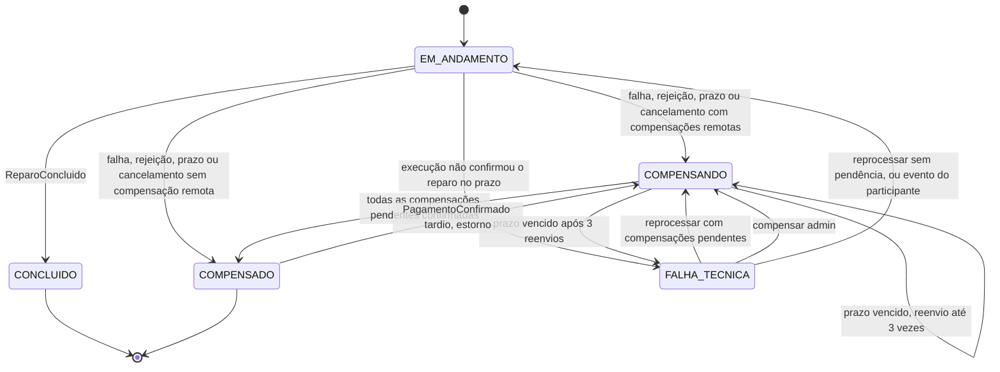
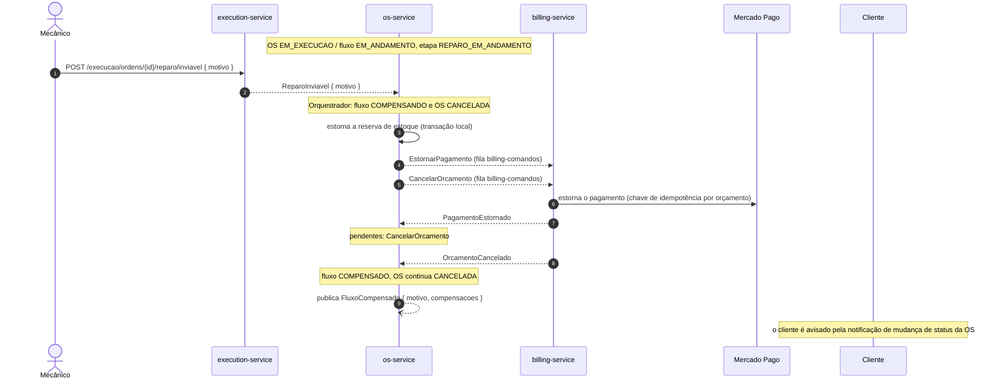
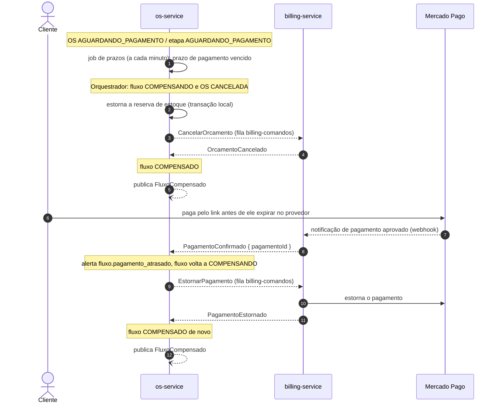

# Sequência — Compensações da Saga

Como o orquestrador desfaz o que já foi feito quando o fluxo da OS não pode seguir até o fim
(Saga Pattern com compensações; no código, `OrquestradorOrdemServico` e a função pura
`decidir()` em `src/modules/orquestracao-os/domain/fluxo-ordem-servico.ts`). O caminho feliz
está em [sequencia-fluxo-os.md](sequencia-fluxo-os.md); a visão estrutural em
[visao-geral-microsservicos.md](visao-geral-microsservicos.md).

## Estados do fluxo

A OS vai para `CANCELADA` **no momento em que a compensação começa** (transição `cancelar`
aplicada junto com a mudança para `COMPENSANDO` ou `COMPENSADO`), não quando o último
participante confirma. A reserva de estoque é estornada na mesma transação local. O fluxo só
chega a `COMPENSADO` (e só então publica o evento informativo `FluxoCompensado`) quando todas
as compensações remotas pendentes foram confirmadas.

## (a) Reparo inviável depois do pagamento

O mecânico declara o reparo inviável (`POST /execucao/ordens/{id}/reparo/inviavel`). O
dinheiro já foi pago e o estoque já foi reservado, então as três coisas são desfeitas. Não há
`CancelarExecucao`, porque o próprio `execution-service` originou o `ReparoInviavel`.

Se o estorno falhar no provedor, o billing responde `EstornoFalhou { proximaTentativaEm }`,
reagenda a própria tentativa e o orquestrador apenas empurra o prazo da compensação para
depois dela (e registra o alerta `fluxo.estorno_falhou`).

## (b) Pagamento atrasado

O prazo de pagamento vence antes de o cliente pagar: o orquestrador compensa. Se o pagamento
chegar depois (o cliente ainda tinha o link aberto), o orquestrador reabre a compensação só
para estornar.

Quando o pagamento tardio é o evento chegando, o billing registra o pagamento sobre o
orçamento já `CANCELADO` marcando-o como atrasado (`pagamentoAtrasado`). No orquestrador, o
mesmo `pagamentoId` entregue duas vezes é ignorado.

> **Mercado Pago:** o adapter de pagamento do billing hoje é simulado
> (`gateway-pagamento.simulado.ts`, atrás de `GatewayPagamentoPort`), e não há controller de
> webhook. A chegada do `PagamentoConfirmado` e o estorno no provedor são o comportamento
> esperado do adapter real; no código atual o estorno é simulado e o evento de pagamento só é
> construído pelos testes.

## Tabela de compensações como implementada

Cada linha é uma ramificação de `decidir()`. "Reserva" é o estorno local do estoque
(`EstornarReservaEstoque`, executado pelo próprio `os-service`); as demais compensações são
comandos enviados pelas filas dos participantes. Se a coluna "Comandos" estiver vazia, o fluxo
vai direto para `COMPENSADO`.

| Quando (etapa do fluxo e gatilho) | Comandos enviados | Reserva | Observação |
| --- | --- | --- | --- |
| `AGUARDANDO_ACK_DIAGNOSTICO`, prazo de resposta vencido | `CancelarExecucao` | não | A execução pode já ter criado a ordem sem responder. |
| Etapas de diagnóstico (`AGUARDANDO_ACK_DIAGNOSTICO`, `AGUARDANDO_DIAGNOSTICO`, `DIAGNOSTICO_EM_ANDAMENTO`), cancelamento pela equipe (`POST /os/{id}/cancelar`, só administrador) | `CancelarExecucao` | não | |
| Etapas de diagnóstico, `DiagnosticoRejeitado` | — | não | A própria execução encerrou a ordem. |
| Fim do diagnóstico com itens inválidos (`ITENS_INVALIDOS`: sem serviço, item fora do catálogo ou total zero) | — | não | Nada foi reservado. |
| `AGUARDANDO_ESTOQUE` (OS bloqueada), cancelamento pela equipe | — | não | Nada reservado e a ordem de diagnóstico já terminou. |
| `AGUARDANDO_ORCAMENTO`, `FalhaGerarOrcamento` | — | sim | O billing já devolveu o motivo, não há orçamento a cancelar. |
| `AGUARDANDO_ORCAMENTO`, prazo de resposta vencido | `CancelarOrcamento` | sim | |
| `AGUARDANDO_APROVACAO`, `OrcamentoRejeitado` | `CancelarOrcamento` | sim | |
| `AGUARDANDO_APROVACAO`, prazo de aprovação vencido | `CancelarOrcamento` | sim | |
| `AGUARDANDO_PAGAMENTO`, prazo de pagamento vencido | `CancelarOrcamento` | sim | |
| Etapas de orçamento (`AGUARDANDO_ORCAMENTO`, `AGUARDANDO_APROVACAO`, `AGUARDANDO_PAGAMENTO`), cancelamento pela equipe | `CancelarOrcamento` | sim | |
| Etapas de reparo (`AGUARDANDO_ACK_REPARO`, `AGUARDANDO_REPARO`, `REPARO_EM_ANDAMENTO`), `ReparoInviavel` | `EstornarPagamento`, `CancelarOrcamento` | sim | Sem `CancelarExecucao`: a execução originou o evento. |
| Etapas de reparo, cancelamento pela equipe | `CancelarExecucao`, `EstornarPagamento`, `CancelarOrcamento` | sim | |
| `FINALIZADO` (fluxo `CONCLUIDO`) | — | — | Ponto sem volta: `FINALIZADA` não aceita `cancelar`, e o fluxo concluído ignora novos eventos. |
| Fluxo `COMPENSANDO` ou `COMPENSADO`, `PagamentoConfirmado` (pagamento atrasado) | `EstornarPagamento` | não | Fluxo volta a `COMPENSANDO`; alerta `fluxo.pagamento_atrasado`. |
| Fluxo `EM_ANDAMENTO` antes da aprovação (diagnóstico, estoque, orçamento), `PagamentoConfirmado` | `EstornarPagamento` | não | Estorno avulso, o fluxo não muda; alerta `fluxo.pagamento_inesperado`. |
| Fluxo `COMPENSADO` ou `CONCLUIDO` recebe `ExecucaoEnfileirada` (ordem criada depois do fim do fluxo) | `CancelarExecucao` | não | Cancelamento tardio de execução; alerta `fluxo.cancelamento_tardio`. O `execution-service` também recusa a criação quando já registrou o cancelamento do fluxo e responde `ExecucaoCancelada`. |
| `AGUARDANDO_ACK_REPARO`, prazo de resposta vencido | — | — | Não compensa: o pagamento já foi feito. Fluxo vai para `FALHA_TECNICA` (alerta `fluxo.falha_tecnica`). |

### Confirmações, reenvios e `FALHA_TECNICA`

- Cada confirmação (`ExecucaoCancelada`, `OrcamentoCancelado`, `PagamentoEstornado`) baixa a
  compensação correspondente da lista de pendentes. Confirmação de algo que não estava
  pendente é ignorada. Com a lista vazia, o fluxo vira `COMPENSADO` e publica `FluxoCompensado`
  com o motivo e as compensações feitas.
- Enquanto há pendentes, o prazo da compensação é o de resposta do serviço
  (`PRAZO_RESPOSTA_SERVICO`, 10 minutos por padrão). Ao vencer, o job reenvia **todos** os
  comandos pendentes, incrementa `tentativas` e registra `fluxo.compensacao_atrasada`. São
  **3 reenvios** no máximo; no vencimento seguinte o fluxo vai para `FALHA_TECNICA` com o
  alerta `fluxo.compensacao_travada`.
- `FALHA_TECNICA` pede ação humana. `POST /orquestracao/fluxos/{fluxoId}/reprocessar` reenvia
  as compensações pendentes (fluxo volta a `COMPENSANDO`, `tentativas` zeradas) ou, sem
  pendências, reenvia o comando que aguardava resposta (fluxo volta a `EM_ANDAMENTO`).
  `POST /orquestracao/fluxos/{fluxoId}/compensar` força a compensação da etapa atual somada às
  pendentes. Se um evento esperado do participante (`ExecucaoEnfileirada`, `ReparoIniciado`,
  `ReparoConcluido`, `ReparoInviavel`) chegar e não houver compensação pendente, o fluxo
  retoma sozinho.
- Os reenvios saem com `messageId` novo. Os participantes são idempotentes pelo estado: um
  estorno já feito, por exemplo, só reemite `PagamentoEstornado`, sem repetir o efeito.

## Notas

- **Ordem de chegada.** SQS não ordena: `CancelarOrcamento` pode chegar ao billing antes do
  `GerarOrcamento`, e `CancelarExecucao` antes da criação da ordem. Os participantes registram
  o cancelamento antecipado e respondem (`OrcamentoCancelado` com `orcamentoId` nulo,
  `ExecucaoCancelada`), e o orquestrador usa o mesmo evento para fechar a compensação.
- **Contramedidas de consistência.** O estorno de reserva e a decisão do fluxo ocorrem na mesma
  transação, sob `SELECT ... FOR UPDATE` do `FluxoOrdemServico`; no billing, a escrita
  condicional por `versao` no DynamoDB impede o _lost update_ entre aprovação e cancelamento
  concorrentes.
