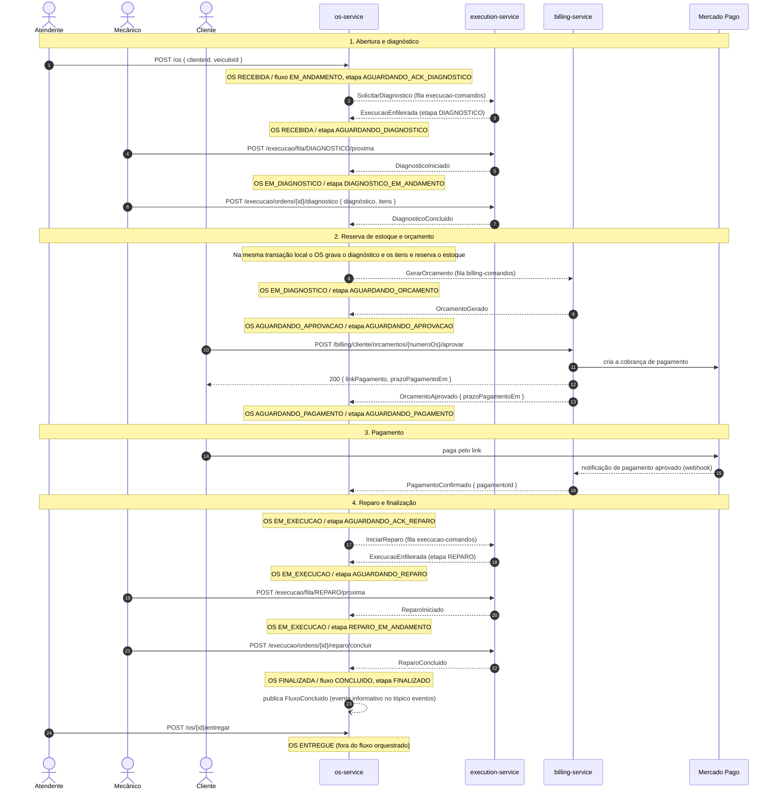

# Sequência — Fluxo da ordem de serviço entre os microsserviços

Caminho feliz da OS, da abertura à finalização, atravessando `os-service`, `execution-service`
e `billing-service`. O `os-service` hospeda o **orquestrador da Saga** (Saga Pattern): o módulo
`orquestracao-os`, com a classe `OrquestradorOrdemServico` e a entidade de estado
`FluxoOrdemServico`. Ele é o único que decide o próximo passo: envia **comandos** pelas filas
SQS dos participantes e consome os **eventos** de resposta da fila `os-orquestrador-eventos`.
Visão estrutural em [visao-geral-microsservicos.md](visao-geral-microsservicos.md); o caminho
de falha está em [sequencia-compensacao.md](sequencia-compensacao.md).

Setas tracejadas (`-->>`) são mensagens assíncronas (SQS/SNS); setas cheias (`->>`) são
chamadas HTTP. Cada `Note over OS` mostra o status da OS (`OsStatus`) e a etapa do fluxo
(`EtapaFluxoOs`) **depois** de a mensagem anterior ser processada.

## Etapas do fluxo e status da OS

| Etapa do fluxo (`EtapaFluxoOs`) | Aguarda | Status da OS | Prazo |
| --- | --- | --- | --- |
| `AGUARDANDO_ACK_DIAGNOSTICO` | `ExecucaoEnfileirada` ou `DiagnosticoIniciado` | `RECEBIDA` | resposta do serviço |
| `AGUARDANDO_DIAGNOSTICO` | `DiagnosticoIniciado` (mecânico pega a ordem) | `RECEBIDA` | sem prazo |
| `DIAGNOSTICO_EM_ANDAMENTO` | `DiagnosticoConcluido` | `EM_DIAGNOSTICO` | sem prazo |
| `AGUARDANDO_ESTOQUE` | reposição de estoque e nova tentativa de reserva | `BLOQUEADA` | sem prazo |
| `AGUARDANDO_ORCAMENTO` | `OrcamentoGerado` | `EM_DIAGNOSTICO` | resposta do serviço |
| `AGUARDANDO_APROVACAO` | `OrcamentoAprovado` ou `OrcamentoRejeitado` | `AGUARDANDO_APROVACAO` | aprovação |
| `AGUARDANDO_PAGAMENTO` | `PagamentoConfirmado` | `AGUARDANDO_PAGAMENTO` | `prazoPagamentoEm` do evento de aprovação |
| `AGUARDANDO_ACK_REPARO` | `ExecucaoEnfileirada` ou `ReparoIniciado` | `EM_EXECUCAO` | resposta do serviço |
| `AGUARDANDO_REPARO` | `ReparoIniciado` | `EM_EXECUCAO` | sem prazo |
| `REPARO_EM_ANDAMENTO` | `ReparoConcluido` | `EM_EXECUCAO` | sem prazo |
| `FINALIZADO` | — | `FINALIZADA` | — |

O estado do fluxo (`StatusFluxoOs`) é separado da etapa: `EM_ANDAMENTO`, `COMPENSANDO`,
`CONCLUIDO`, `COMPENSADO` e `FALHA_TECNICA` (detalhes em
[sequencia-compensacao.md](sequencia-compensacao.md)).

## Notas

- **Prazos** (variáveis de ambiente do `os-service`, em minutos): `PRAZO_RESPOSTA_SERVICO`
  (10) para a confirmação de comandos pelos participantes, `PRAZO_APROVACAO` (4320, três dias)
  e `PRAZO_PAGAMENTO` (2880, dois dias). O prazo de aprovação segue no comando
  `GerarOrcamento`, junto de `prazoPagamentoMinutos`; o billing devolve o instante de
  vencimento do pagamento em `OrcamentoAprovado.prazoPagamentoEm`. Um job do `os-service`
  roda a cada minuto, avalia os fluxos com prazo vencido e dispara o evento interno de prazo
  expirado.
- **Estoque.** A reserva acontece no `os-service`, dentro da transação que processa o
  `DiagnosticoConcluido`, antes de qualquer passo que envolva dinheiro. Sem estoque suficiente
  a OS vai para `BLOQUEADA` (etapa `AGUARDANDO_ESTOQUE`, sem prazo); a equipe repõe o estoque e
  chama `POST /os/{id}/desbloquear`, e o job também tenta de novo a cada minuto. A reserva
  bem-sucedida desbloqueia a OS (`EM_DIAGNOSTICO`) e o fluxo segue para o orçamento.
- **Pagamento por último.** O pagamento é o último passo antes do reparo e a reserva já está
  feita: se o fluxo for cancelado depois, o estorno do dinheiro e o estorno da reserva são
  compensações explícitas (contramedida de **Visão Pessimista** contra _dirty read_; ver
  [ADR-008](adrs/adr-008-saga-orquestrada.md)).
- **Pagamento em atraso na aprovação.** Se `PagamentoConfirmado` chega com o fluxo ainda em
  `AGUARDANDO_APROVACAO`, o orquestrador aplica `orcamento_aprovado` e `pagamento_confirmado`
  em sequência e segue direto para o reparo.
- **Idempotência.** Cada mensagem tem `messageId`; o orquestrador registra as processadas e
  descarta duplicatas, lê o fluxo sob `SELECT ... FOR UPDATE` (rever o valor antes de
  atualizar) e ignora eventos que não fazem sentido na etapa atual (SQS não garante ordem).
- **Mercado Pago.** O adapter de pagamento do `billing-service` hoje é **simulado**
  (`gateway-pagamento.simulado.ts`, atrás da porta `GatewayPagamentoPort`); o Mercado Pago é o
  adapter-alvo da mesma porta. Por isso o diagrama mostra a criação da cobrança e a
  notificação de pagamento como o desenho final. No código atual a cobrança devolve um link
  simulado, não há controller de webhook e nenhum fluxo do billing publica
  `PagamentoConfirmado` (só os testes constroem esse evento); o passo 3 do diagrama é,
  portanto, o comportamento esperado do adapter real. O contrato do evento e a reação do
  orquestrador já existem e não mudam quando ele entrar.
- **Mecânico e atendente.** As filas do `execution-service` são consumidas por mecânicos via
  HTTP (`fila/{etapa}/proxima`), não por worker automático. A entrega (`ENTREGUE`) é uma ação
  do atendente depois que o fluxo já terminou.
