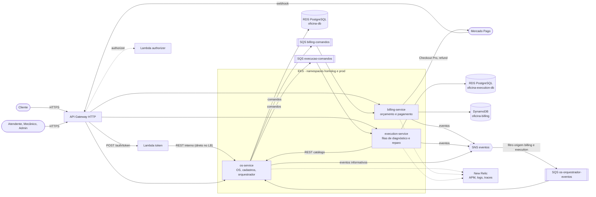

# Visão geral — arquitetura de microsserviços

Arquitetura final da solução da oficina na Fase 4: o monólito da Fase 3 foi dividido em três
microsserviços (OS, Billing e Execution), cada um com o seu banco, coordenados por uma
**Saga orquestrada** (Saga Pattern) e ligados por mensageria SNS/SQS. A borda continua sendo
o API Gateway com autenticação por CPF via Lambda.

Este documento mostra os componentes, os bancos e a comunicação entre eles. O fluxo da Saga
(passos, compensações) e as decisões estão nas ADRs — em especial a
[ADR-008](adrs/adr-008-saga-orquestrada.md) (Saga orquestrada) e a
[ADR-009](adrs/adr-009-mensageria-sns-sqs.md) (mensageria SNS/SQS); os nomes de filas, tópico,
mensagens e rotas internas estão em [`contratos/README.md`](../../contratos/README.md).

Legenda: linha cheia é chamada ou mensagem de negócio; linha pontilhada é autorização na
borda ou telemetria. Os nomes físicos das filas e do tópico levam o prefixo
`oficina-<env>-` (por exemplo `oficina-prod-execucao-comandos`), e cada fila tem uma
DLQ `-dlq`. O diagrama omite as DLQs e o ambiente para não poluir a figura.

## Serviços

| Serviço | Responsabilidade | Banco | Repositório |
| --- | --- | --- | --- |
| `os-service` | Cadastros (clientes, veículos, catálogo de serviços, insumos e estoque, usuários), login da equipe, ordem de serviço (abertura, status, histórico, acompanhamento do cliente, entrega) e o **orquestrador da Saga** (módulo `orquestracao-os`): decide o próximo passo de cada fluxo, envia comandos, consome eventos, aplica compensações e controla prazos. | RDS PostgreSQL `oficina-db` (bancos lógicos `oficina_homolog` e `oficina_prod`) | [tc-oficina-os-service](https://github.com/FIAP-POS-TECH-SOFTWARE-ARCHITECTURE/tc-oficina-os-service) |
| `billing-service` | Orçamento gerado a partir do snapshot recebido no comando, aprovação ou rejeição pelo cliente, pagamento e estorno. O pagamento fica atrás da porta `GatewayPagamentoPort`; o adapter atual é simulado (`gateway-pagamento.simulado.ts`) e o Mercado Pago (Checkout Pro, webhook, refund) é o adapter-alvo da mesma porta. | DynamoDB `oficina-billing-<env>` | [tc-oficina-billing-service](https://github.com/FIAP-POS-TECH-SOFTWARE-ARCHITECTURE/tc-oficina-billing-service) |
| `execution-service` | Fila de diagnóstico e fila de reparo: o mecânico reserva a próxima ordem (`SELECT ... FOR UPDATE SKIP LOCKED`), registra o diagnóstico com os itens necessários (consultando o catálogo do OS), executa e conclui o reparo, ou declara o diagnóstico rejeitado / reparo inviável. | RDS PostgreSQL `oficina-execution-db` (bancos lógicos `execution_homolog` e `execution_prod`) | [tc-oficina-execution-service](https://github.com/FIAP-POS-TECH-SOFTWARE-ARCHITECTURE/tc-oficina-execution-service) |

A borda e a infraestrutura vivem em repositórios próprios:
[tc-oficina-lambda-auth](https://github.com/FIAP-POS-TECH-SOFTWARE-ARCHITECTURE/tc-oficina-lambda-auth)
(API Gateway, Lambda token e Lambda authorizer),
[tc-oficina-infra-k8s](https://github.com/FIAP-POS-TECH-SOFTWARE-ARCHITECTURE/tc-oficina-infra-k8s)
(VPC, EKS, ECR, namespaces, SNS/SQS) e
[tc-oficina-infra-db](https://github.com/FIAP-POS-TECH-SOFTWARE-ARCHITECTURE/tc-oficina-infra-db)
(RDS e DynamoDB).

## Comunicação

| Tipo | Origem → destino | Mecanismo | Por quê |
| --- | --- | --- | --- |
| Síncrona | Cliente / equipe → serviços | API Gateway HTTP API com proxy HTTP: `/billing/*` → billing, `/execucao/*` → execution, demais rotas → OS; rotas sensíveis do cliente passam pelo Lambda authorizer. `/internal/*` é bloqueado no gateway. | Ponto único de entrada, autenticação do cliente na borda e `x-request-id` para correlação. |
| Síncrona | Lambda token → OS | `GET /internal/clientes/por-documento/:documento`, direto no LoadBalancer do OS (não passa pelo gateway), com o header `x-internal-api-key`. | A Lambda precisa saber só se o CPF é de um cliente ativo; o OS é o dono dos clientes, então ela perdeu o acesso direto ao RDS. |
| Síncrona | execution → OS | `GET /internal/catalogo/servicos` e `/internal/catalogo/insumos`, por DNS interno do cluster, com `x-internal-api-key`. | O mecânico monta o diagnóstico com serviços e insumos reais do catálogo; precisa de resposta imediata para validar os itens, e o catálogo continua pertencendo ao OS. |
| Síncrona | billing → Mercado Pago | Criação da preferência de pagamento (Checkout Pro) e estorno (refund); o Mercado Pago chama de volta pelo webhook do gateway. É o adapter-alvo de `GatewayPagamentoPort`; hoje o adapter em uso é simulado. | O pagamento é um sistema externo; a porta isola o restante do billing da escolha do provedor. |
| Assíncrona | OS → execution e OS → billing | Comandos em filas SQS dedicadas: `execucao-comandos` e `billing-comandos`. | Cada fila tem um único consumidor; o OS não espera a resposta e o serviço pode estar fora do ar sem perder o comando. Falha repetida vai para a DLQ. |
| Assíncrona | billing, execution (e OS) → OS | Eventos publicados no tópico SNS `eventos`; a fila `os-orquestrador-eventos` assina o tópico com filtro `origem` em `billing` e `execution`. | O orquestrador recebe os resultados em uma fila só, sem que billing e execution conheçam o OS; o tópico deixa espaço para novos assinantes. Os eventos que o próprio OS publica são informativos e o filtro os descarta. |

As mensagens assíncronas são entregues pelo menos uma vez: cada consumidor guarda o
`messageId` junto do efeito de domínio (tabela `mensagens_processadas` nos serviços
PostgreSQL; item de dedupe no DynamoDB) e a publicação usa outbox, para não perder nem
duplicar efeitos.

## Regra de dados

- Cada serviço tem o seu banco e **nenhum serviço lê o banco de outro**. O que um serviço
  precisa de outro chega por mensagem (o comando de orçamento carrega o snapshot de itens,
  preços e cliente) ou por REST.
- A Lambda token da Fase 3 consultava o RDS do monólito para validar o cliente. Na Fase 4
  ela chama o endpoint interno do OS e a credencial de banco saiu da Lambda: o OS é o único
  que acessa o `oficina-db`.
- Os bancos seguem a necessidade de cada serviço: PostgreSQL para o OS e o execution (dados
  relacionais e transações), DynamoDB para o billing (orçamento como agregado único, com
  escrita condicional por versão).

## Ambientes

- **Namespaces:** `homolog` (branch `develop`) e `prod` (branch `main`) no mesmo cluster
  EKS `oficina-eks`. Os três serviços dividem os namespaces, por isso todo recurso
  Kubernetes é prefixado pelo nome do serviço (`os-service`, `billing-service`,
  `execution-service`). Serviços falam entre si por `http://<serviço>.<env>.svc.cluster.local`.
- **Bancos lógicos:** `oficina_homolog` / `oficina_prod` na instância `oficina-db`;
  `execution_homolog` / `execution_prod` na instância `oficina-execution-db`; tabelas
  DynamoDB `oficina-billing-homolog` / `oficina-billing-prod`.
- **Mensageria por ambiente:** um conjunto próprio de filas, DLQs e tópico por ambiente
  (`oficina-homolog-*` e `oficina-prod-*`). Os endereços chegam aos pods pelo SSM
  (`/oficina/<env>/mensageria/...`). Para desenvolvimento local há ainda o ambiente `local`,
  que existe só no emulador MiniStack.
- **Observabilidade:** os três serviços reportam ao New Relic, com o `requestId` do gateway
  propagado nas mensagens.

Detalhes de nomes, envelope e rotas: [contratos/README.md](../../contratos/README.md). A
visão de nuvem da Fase 3 (que originou esta) continua em [componentes.md](componentes.md).
