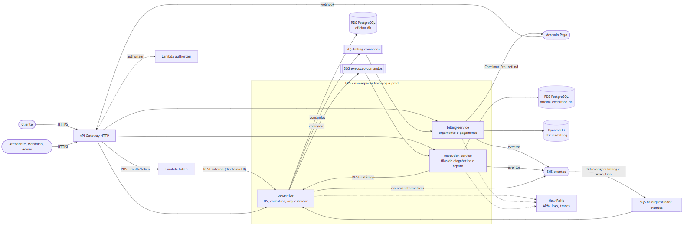
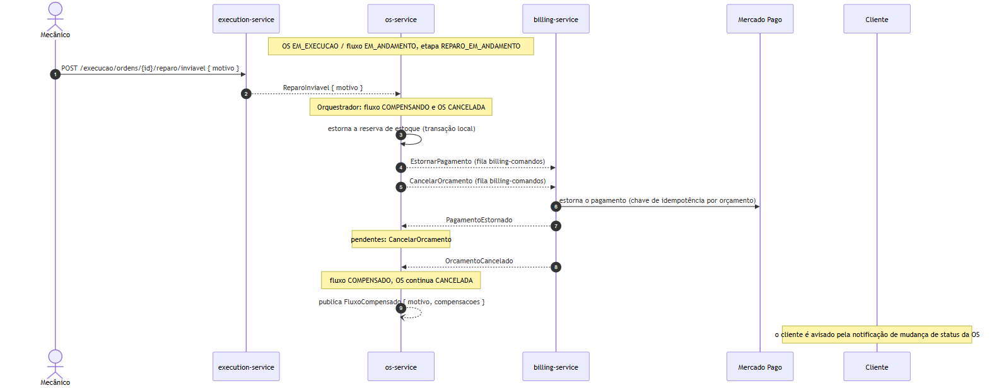
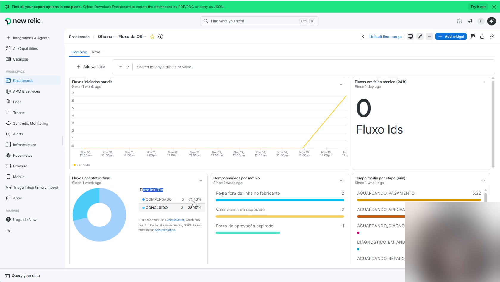
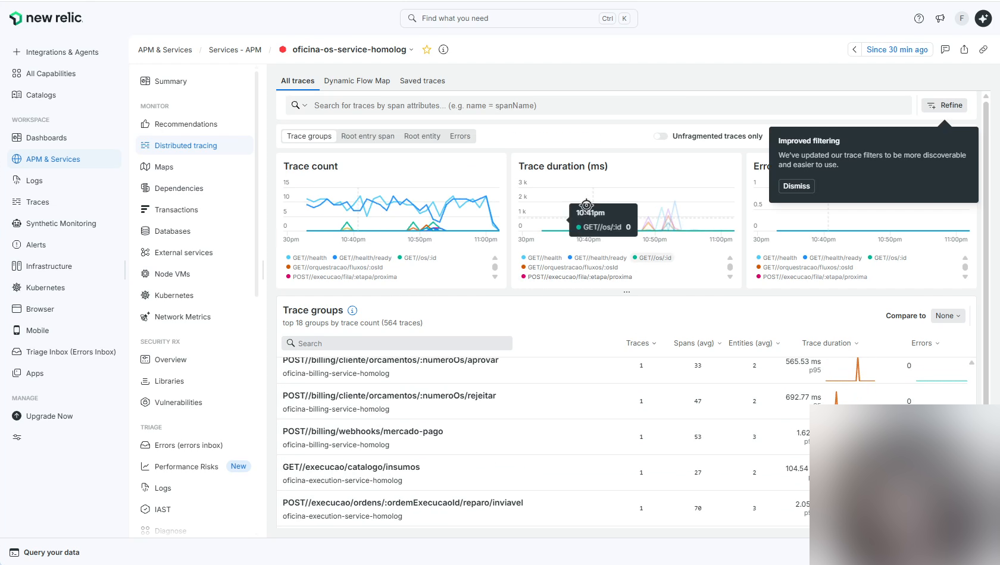
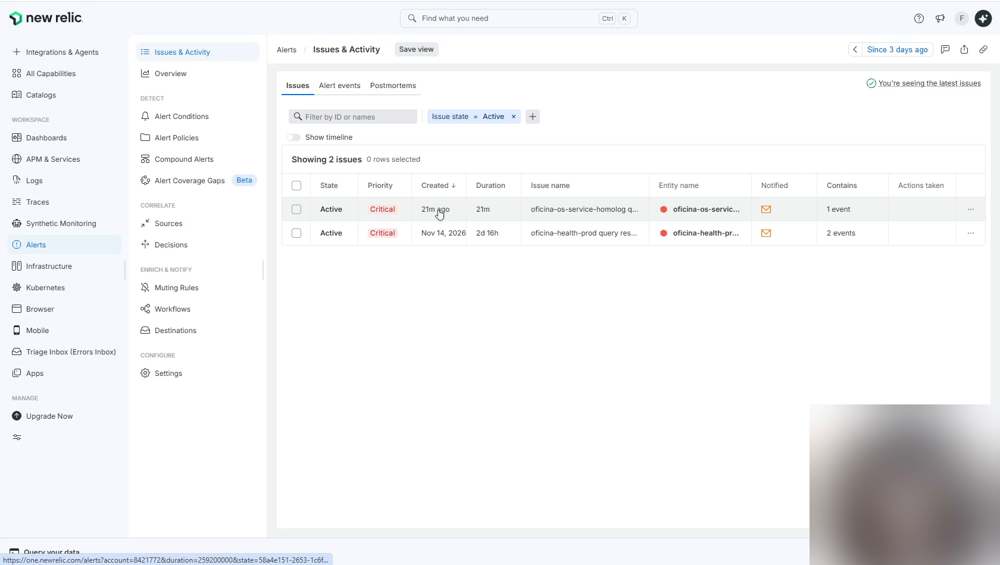

# Tech Challenge Fase 4: Grupo Integradores

> Fonte Markdown do documento de entrega. O PDF submetido no Portal do Aluno é gerado a partir
> deste conteúdo, com os diagramas embutidos como imagem.

## 1. Identificação

- **Curso:** Pós-graduação em Software Architecture (FIAP Pós Tech), turma **15SOAT**
- **Grupo:** Integradores

| Nome completo | RM |
|---|---|
| Lucas Gardini Dias | 372237 |
| Thiago Aio | 372238 |

## 2. Links dos repositórios

Todos na organização `FIAP-POS-TECH-SOFTWARE-ARCHITECTURE`, **públicos** (acesso livre de
leitura a código, Pull Requests, execuções do GitHub Actions e regras de proteção de branch).
Cada microsserviço tem repositório, banco, imagem e pipeline de CI/CD próprios.

| Repositório | Papel |
|---|---|
| <https://github.com/FIAP-POS-TECH-SOFTWARE-ARCHITECTURE/tc-oficina-os-service> | Microsserviço de OS: cadastros, ordem de serviço e orquestrador da Saga (PostgreSQL) |
| <https://github.com/FIAP-POS-TECH-SOFTWARE-ARCHITECTURE/tc-oficina-billing-service> | Microsserviço de orçamento e pagamento com Mercado Pago (DynamoDB) |
| <https://github.com/FIAP-POS-TECH-SOFTWARE-ARCHITECTURE/tc-oficina-execution-service> | Microsserviço de execução: filas de diagnóstico e reparo (PostgreSQL) |
| <https://github.com/FIAP-POS-TECH-SOFTWARE-ARCHITECTURE/tc-oficina-lambda-auth> | Borda: API Gateway HTTP API, Lambda de token por CPF e Lambda authorizer |
| <https://github.com/FIAP-POS-TECH-SOFTWARE-ARCHITECTURE/tc-oficina-infra-k8s> | Terraform: VPC, EKS, ECR por serviço e mensageria SNS/SQS |
| <https://github.com/FIAP-POS-TECH-SOFTWARE-ARCHITECTURE/tc-oficina-infra-db> | Terraform: RDS PostgreSQL (OS e Execution) e DynamoDB (Billing) |

Documentação arquitetural completa (visão geral, sequências, ADRs, RFCs, banco de dados):
<https://github.com/FIAP-POS-TECH-SOFTWARE-ARCHITECTURE/tc-oficina-os-service/tree/main/docs/arquitetura>.
Checklist requisito → evidência:
<https://github.com/FIAP-POS-TECH-SOFTWARE-ARCHITECTURE/tc-oficina-os-service/blob/main/docs/entrega/checklist-requisitos-fase-4.md>.

## 3. Vídeo de demonstração

<https://www.youtube.com/watch?v=Sf_hejh9kxk> (não listado, 14:38).

| Início | Bloco |
|---|---|
| 0:04 | Arquitetura geral |
| 1:01 | Microsserviços e bancos |
| 2:24 | Saga orquestrada |
| 4:22 | Fluxo completo de uma OS, com pagamento no Mercado Pago |
| 6:55 | Falha e compensação (reparo inviável, estorno, DLQ e alerta) |
| 9:14 | Deploy automatizado |
| 11:23 | Monitoramento e rastreamento |
| 13:55 | Encerramento |

O vídeo cobre, nesta ordem: fluxo completo de uma OS passando pelos três microsserviços (com
pagamento no Mercado Pago), execução da Saga com compensação e tratamento de falhas, deploy
automatizado de um microsserviço com validação de testes e monitoramento com rastreamento
distribuído no New Relic.

## 4. Diagrama geral da arquitetura

Três microsserviços no EKS (namespaces `homolog` e `prod`), cada um com o seu banco: `os-service`
no RDS PostgreSQL `oficina-db`, `execution-service` no RDS PostgreSQL `oficina-execution-db` e
`billing-service` no DynamoDB `oficina-billing-<env>`. A borda é o API Gateway HTTP API, com
autenticação do cliente por CPF via Lambda. A comunicação síncrona passa pelo gateway (cliente e
equipe) e por REST interno (Lambda → OS para validar o cliente; Execution → OS para consultar o
catálogo; Billing → Mercado Pago). A assíncrona usa filas SQS de comando
(`execucao-comandos`, `billing-comandos`) e um tópico SNS de eventos, assinado pela fila
`os-orquestrador-eventos` com filtro de origem; toda fila tem DLQ. Os três serviços enviam APM,
logs e traces ao New Relic.

Fonte do diagrama:
[visao-geral-microsservicos.md](https://github.com/FIAP-POS-TECH-SOFTWARE-ARCHITECTURE/tc-oficina-os-service/blob/main/docs/arquitetura/visao-geral-microsservicos.md).

## 5. Estratégia da Saga: orquestração

**Escolha:** Saga **orquestrada**, com o orquestrador dentro do `os-service` (módulo
`orquestracao-os`). No código, o orquestrador é o `OrquestradorOrdemServico` e cada instância da
Saga é um `FluxoOrdemServico` (uma linha por OS na tabela `fluxos_ordem_servico`), com a etapa
atual e o status (`EM_ANDAMENTO`, `COMPENSANDO`, `CONCLUIDO`, `COMPENSADO`, `FALHA_TECNICA`).
O orquestrador envia comandos às filas do Execution e do Billing, consome os eventos deles numa
fila própria e controla prazos com um job a cada minuto (aprovação, pagamento e resposta dos
serviços).

**Por que orquestrada e não coreografada.** O fluxo tem sete passos, prazos e compensações que
dependem da etapa em que a OS está. Na coreografia, a regra "o que desfazer em cada ponto" ficaria
espalhada entre três serviços, sem dono, e cada serviço precisaria conhecer os eventos dos
outros. Com o orquestrador, fluxo e compensações ficam num lugar só, o teste BDD do fluxo
completo roda contra o orquestrador real e o estado da Saga é consultável numa rota
(`GET /orquestracao/fluxos/:osId`). Um orquestrador como quarto serviço foi descartado porque o
OS já é dono da OS e do estoque: a reserva de estoque e a mudança de status virariam chamadas
remotas.

**Consistência.** Cada decisão do orquestrador (mudar a etapa, mudar o status da OS, reservar ou
estornar estoque e gravar o próximo comando no outbox) acontece numa única transação PostgreSQL,
começando por `SELECT ... FOR UPDATE` na linha do fluxo. As mensagens são publicadas por outbox e
consumidas de forma idempotente por `messageId`. Contra a falta de isolamento da Saga, o projeto
aplica duas contramedidas: **visão pessimista** (a reserva de estoque vem antes de qualquer passo
de dinheiro, e o pagamento é o último passo antes do reparo) e **reler valor** (lock da linha do
fluxo no orquestrador; escrita condicional por `versao` no DynamoDB do Billing).

### Passos e compensações

| # | Passo | Serviço | Tipo | Compensação se algo falhar depois |
|---|---|---|---|---|
| 1 | Abertura da OS → `SolicitarDiagnostico` | os → execution | compensável | `CancelarExecucao` |
| 2 | Diagnóstico (`DiagnosticoIniciado`, `DiagnosticoConcluido`) | execution → os | compensável | diagnóstico rejeitado ou itens inválidos cancelam a OS sem nada a desfazer |
| 3 | Reserva de estoque (local) → `GerarOrcamento` | os → billing | compensável | estorno da reserva |
| 4 | `OrcamentoGerado` → aprovação pelo cliente | billing | compensável | `CancelarOrcamento` + estorno da reserva (rejeição ou prazo) |
| 5 | `OrcamentoAprovado` → pagamento no Mercado Pago | billing | compensável | `CancelarOrcamento` + estorno da reserva (prazo de pagamento) |
| 6 | `PagamentoConfirmado` → `IniciarReparo` | billing → os → execution | compensável só por falha de negócio | `ReparoInviavel`: `EstornarPagamento` + `CancelarOrcamento` + estorno da reserva; falha técnica leva a `FALHA_TECNICA` (decisão de um administrador) |
| 7 | `ReparoConcluido` | execution → os | **pivô** (ponto sem volta) | nenhuma: reparo feito e pago não se desfaz |
| depois | `FluxoConcluido`, entrega da OS | os | retentável | não se aplica |

Compensação sem resposta no prazo é reenviada até 3 vezes antes de o fluxo ir a `FALHA_TECNICA`.
Se o estorno falhar no Mercado Pago, o Billing deixa o orçamento em `ESTORNO_PENDENTE`, publica
`EstornoFalhou` e tenta de novo sozinho (1, 5, 15 e 60 minutos, depois de hora em hora); o
orquestrador adia o prazo em vez de travar.

### Diagrama de sequência da compensação (reparo inviável depois do pagamento)

Decisão completa:
[ADR-008](https://github.com/FIAP-POS-TECH-SOFTWARE-ARCHITECTURE/tc-oficina-os-service/blob/main/docs/arquitetura/adrs/adr-008-saga-orquestrada.md).
Tabela de compensações como implementada:
[sequencia-compensacao.md](https://github.com/FIAP-POS-TECH-SOFTWARE-ARCHITECTURE/tc-oficina-os-service/blob/main/docs/arquitetura/sequencia-compensacao.md).

## 6. Justificativa da divisão dos microsserviços e das tecnologias

### Divisão em três serviços

Seguimos a divisão sugerida pelo enunciado, com o monólito da Fase 3 evoluindo para o
`os-service`. O diagnóstico saiu do OS e foi para o Execution, porque o enunciado põe "atualizar
status durante diagnóstico e reparos" no serviço de execução; o orçamento (gerar, aprovar,
rejeitar) saiu do OS e foi para o Billing, porque "geração e envio de orçamentos" é cobrança. Não
há biblioteca compartilhada: o contrato das mensagens fica versionado em `contratos/` de cada
repositório, e o CI do billing e do execution confere que a cópia está sincronizada com a do OS.
([ADR-007](https://github.com/FIAP-POS-TECH-SOFTWARE-ARCHITECTURE/tc-oficina-os-service/blob/main/docs/arquitetura/adrs/adr-007-microsservicos-os-billing-execution.md))

### Mensageria SNS + SQS

Comandos vão por filas SQS dedicadas (uma por serviço que recebe comandos, com um único
consumidor); eventos vão por um tópico SNS, e a fila do orquestrador assina o tópico com
`FilterPolicy` por origem. Toda fila tem DLQ (redrive no 5º recebimento) que dispara alerta. SNS e
SQS são gerenciados e entram no Terraform da plataforma: um RabbitMQ no EKS exigiria operar o
broker e perderia filas e mensagens a cada reset do AWS Academy, enquanto o script de recriação
do ambiente refaz a mensageria junto com o resto. SQS FIFO foi descartado porque ordem e
duplicidade já são tratadas por idempotência no consumidor e pela máquina de estados do
orquestrador.
([ADR-009](https://github.com/FIAP-POS-TECH-SOFTWARE-ARCHITECTURE/tc-oficina-os-service/blob/main/docs/arquitetura/adrs/adr-009-mensageria-sns-sqs.md))

### Banco por serviço

PostgreSQL no OS (cadastros, OS, estoque e o fluxo da Saga precisam de transação e lock de
linha) e no Execution (a fila do mecânico usa `SELECT ... FOR UPDATE SKIP LOCKED`), em instâncias
RDS separadas. DynamoDB no Billing: o orçamento é um agregado único acessado por chave, a
resposta do provedor de pagamento tem esquema variável e a escrita condicional por `versao` dá a
idempotência e a releitura de valor de que o fluxo precisa. Nenhum serviço lê o banco de outro.
([ADR-010](https://github.com/FIAP-POS-TECH-SOFTWARE-ARCHITECTURE/tc-oficina-os-service/blob/main/docs/arquitetura/adrs/adr-010-banco-por-servico.md))

### Infraestrutura de dados centralizada

Os bancos dos três serviços ficam em `tc-oficina-infra-db`, num único root module com arquivos
separados por dono (`os-*.tf`, `execution-*.tf`, `billing-*.tf`) e `prevent_destroy` nos três
bancos. Cada serviço recebe só o que é dele pelo SSM (`/oficina/<env>/...`); os pipelines dos
serviços não rodam Terraform.
([ADR-011](https://github.com/FIAP-POS-TECH-SOFTWARE-ARCHITECTURE/tc-oficina-os-service/blob/main/docs/arquitetura/adrs/adr-011-infra-de-dados-centralizada.md))

### Pagamento antes do reparo, com Mercado Pago

O cliente aprova, paga, e só então o reparo começa (visão pessimista). O Billing cria uma order do
Checkout Pro pela API de Orders, que expira junto com o prazo de pagamento da Saga. O webhook
valida a assinatura `x-signature` e consulta a order na API antes de confirmar; se a notificação
se perder, a equipe aciona a reconciliação. O provedor fica atrás da porta
`GatewayPagamentoPort`, com chave de idempotência em toda chamada que move dinheiro.
([ADR-013](https://github.com/FIAP-POS-TECH-SOFTWARE-ARCHITECTURE/tc-oficina-os-service/blob/main/docs/arquitetura/adrs/adr-013-pagamento-antes-do-reparo-mercado-pago.md))

### Qualidade: SonarQube, BDD e MiniStack

SonarQube Community como service container no GitHub Actions, com o quality gate "Cobertura 80"
reprovando o PR abaixo de 80% (branches incluídas); `coverageThreshold` de 80% no Jest dos três
serviços. BDD com `jest-cucumber` em português, dentro do mesmo Jest. MiniStack como emulador AWS
local (SNS, SQS, DynamoDB, SSM), em desenvolvimento e nos testes de integração via
Testcontainers, sem conta externa.
([ADR-014](https://github.com/FIAP-POS-TECH-SOFTWARE-ARCHITECTURE/tc-oficina-os-service/blob/main/docs/arquitetura/adrs/adr-014-qualidade-sonarqube-bdd-ministack.md))

### Serviço, banco e tecnologias

| Serviço | Banco | Tecnologias |
|---|---|---|
| `os-service` | RDS PostgreSQL 18 `oficina-db` (bancos `oficina_homolog`/`oficina_prod`) | Node.js 25, NestJS 11, Prisma 6, AWS SDK v3 (SNS/SQS), outbox transacional, JSON Schema (Ajv), JWT HS256 + Argon2 |
| `billing-service` | DynamoDB `oficina-billing-homolog`/`oficina-billing-prod` (tabela única, `pk`/`sk`, índice `gsi1`) | Node.js 25, NestJS 11, `@aws-sdk/lib-dynamodb`, SDK `mercadopago` (API de Orders), webhook HMAC `x-signature`, outbox no DynamoDB |
| `execution-service` | RDS PostgreSQL 18 `oficina-execution-db` (bancos `execution_homolog`/`execution_prod`) | Node.js 25, NestJS 11, Prisma 6, `FOR UPDATE SKIP LOCKED`, outbox com relay |
| Comum | | Kubernetes (EKS) com Kustomize, HPA por CPU e rolling update; GitHub Actions; Terraform; API Gateway HTTP API + AWS Lambda (Node.js 22); New Relic (APM, `nestjs-pino`, `nri-bundle`); Jest 30, `jest-cucumber`, Testcontainers, MiniStack; SonarQube |

## 7. Qualidade

Cobertura medida com `npm run test:cov` em cada serviço (todos os testes verdes). O mínimo
exigido é 80%, aplicado no Jest e no quality gate do SonarQube.

| Serviço | Testes | Statements | Branches | Functions | Lines |
|---|---|---|---|---|---|
| `os-service` | 801 (126 suítes) | 98,6% | 88,47% | 98,23% | 98,91% |
| `billing-service` | 463 (52 suítes) | 99,6% | 89,66% | 99,23% | 99,81% |
| `execution-service` | 294 (38 suítes) | 98,36% | 88,74% | 96,06% | 98,7% |

**Quality gate.** O job `Qualidade (SonarQube)` do `ci.yml` de cada serviço sobe um SonarQube,
cria o gate "Cobertura 80" (condições `coverage` e `new_coverage` com erro abaixo de 80%), analisa
o projeto e reprova o PR se o gate falhar. Testes BDD do fluxo completo:
[fluxo-ordem-servico.feature](https://github.com/FIAP-POS-TECH-SOFTWARE-ARCHITECTURE/tc-oficina-os-service/blob/main/test/bdd/features/fluxo-ordem-servico.feature)
(caminho feliz, rejeição, reparo inviável com estorno, falta de estoque, prazo de aprovação,
pagamento atrasado e mensagem duplicada).

Relatórios de cobertura:
[os-service](https://github.com/FIAP-POS-TECH-SOFTWARE-ARCHITECTURE/tc-oficina-os-service/blob/main/docs/evidencias/cobertura.png) ·
[billing-service](https://github.com/FIAP-POS-TECH-SOFTWARE-ARCHITECTURE/tc-oficina-billing-service/blob/main/docs/evidencias/cobertura.png) ·
[execution-service](https://github.com/FIAP-POS-TECH-SOFTWARE-ARCHITECTURE/tc-oficina-execution-service/blob/main/docs/evidencias/cobertura.png).

CI verde no PR de promoção `develop → main` de cada serviço, com o job de qualidade:
[os-service](https://github.com/FIAP-POS-TECH-SOFTWARE-ARCHITECTURE/tc-oficina-os-service/actions/runs/43785127324) ·
[billing-service](https://github.com/FIAP-POS-TECH-SOFTWARE-ARCHITECTURE/tc-oficina-billing-service/actions/runs/43785131215) ·
[execution-service](https://github.com/FIAP-POS-TECH-SOFTWARE-ARCHITECTURE/tc-oficina-execution-service/actions/runs/43785134525).
CD de produção disparado pelo merge na `main`:
[os-service](https://github.com/FIAP-POS-TECH-SOFTWARE-ARCHITECTURE/tc-oficina-os-service/actions/runs/43965593486) ·
[billing-service](https://github.com/FIAP-POS-TECH-SOFTWARE-ARCHITECTURE/tc-oficina-billing-service/actions/runs/43967804295) ·
[execution-service](https://github.com/FIAP-POS-TECH-SOFTWARE-ARCHITECTURE/tc-oficina-execution-service/actions/runs/43965620545).

## 8. Observabilidade

Os três serviços enviam APM, logs estruturados (`nestjs-pino`) e traces ao New Relic. Cada
mensagem publicada pelo outbox carrega os atributos `traceparent`, `tracestate` e `newrelic`, e o
consumidor abre uma transação `OtherTransaction/SQS/mensageria/<tipo>` ligada ao trace de quem
publicou: um fluxo aparece como um único trace atravessando os três serviços. Os logs do
orquestrador levam o `fluxoId`. O dashboard `Oficina — Fluxo da OS` mostra fluxos iniciados e por
status final, compensações por motivo, tempo por etapa, profundidade das DLQs e latência dos três
serviços; a política de alertas cobre mensagem em DLQ, fluxo em falha técnica, compensação
travada e estorno esgotado. Runbook, dashboards versionados e alertas:
<https://github.com/FIAP-POS-TECH-SOFTWARE-ARCHITECTURE/tc-oficina-os-service/tree/main/docs/observabilidade>.

Dashboard `Oficina — Fluxo da OS`, página Homolog, depois dos fluxos da demonstração (5 compensados
e 2 concluídos, compensações por motivo e tempo médio por etapa):

Distributed tracing do `oficina-os-service-homolog`: as rotas do fluxo aparecem em traces com 2 e 3
entidades (por exemplo, o webhook do Mercado Pago e o reparo inviável atravessam três serviços):

Alerta "Mensagem em DLQ" disparado em homolog (mensagem inválida publicada na fila do billing),
com a issue crítica aberta e notificada por e-mail:

